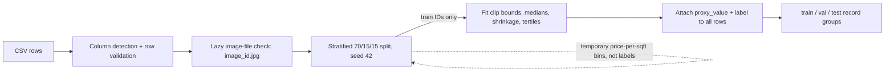
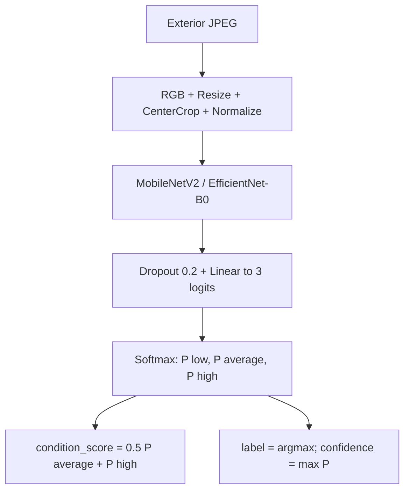
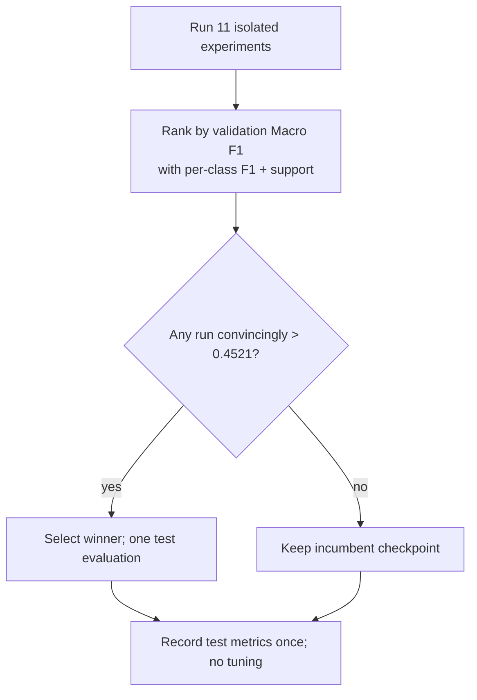
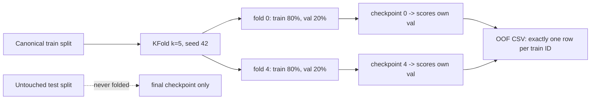

# Final Member A report — CNN visual proxy

**Status: FINAL — Member A is complete.** The pinned `e0_reference_group_split`
CNN trained on Kaggle (best epoch 27, validation Macro F1 `0.4314855`) and its
untouched property-disjoint test split was evaluated **once** (2,308 samples,
test Macro F1 `0.4240`). The one-time gate and sealed metrics exist. The leakage
audit was completed by the property-disjoint split design and its PASS preflight.
Historical random-split results in §7 are preserved verbatim, were not
re-measured, and are **not comparable** with the final run. The live demonstration
was not run. The concise examiner-facing summary is `docs/ACADEMIC_REPORT.md`;
the pending end-to-end pipeline is `docs/FULL_VALUATION_IMPLEMENTATION_PLAN.md`.

> **Interpretation warning.** Every target is a **market-derived visual proxy**
> (a tertile of prices per square foot relative to a shrunken city median),
> **not** a human-annotated physical-condition or aesthetic grade, and **not** a
> price. `condition_score = 0.5·P(average) + 1·P(high)` is a soft feature only.
> See `docs/MODEL_CARD.md`.

---

## 1. Objective and scope

Member A delivers one reusable component: a CNN that maps a property exterior
photograph to a normalized visual-proxy feature for Member B's structural model.
The scope is strictly Member A — no Random Forest, no Linear Regression and no
final price prediction are implemented here.

The deliverables are (a) a self-contained checkpoint and stable `VisionAgent`
API, (b) a controlled experiment harness and audit trail, (c) OOF utilities and a
row contract so Member B never trains on in-sample visual features, and (d) this
report. The **final checkpoint** is
`/kaggle/working/output/experiments/e0_reference_group_split/models/best_model.pth`.
The historical incumbent
`/kaggle/working/output/improved_mobilenet/models/best_model.pth` is preserved as
a random-split reference artifact, not as the final model. The complete interface
and leakage handoff is `docs/MEMBER_A_TECHNICAL_HANDOFF.md`.

## 2. Scientific problem and target definition

The dataset contains no human condition labels. The only available signal is
market-derived. The target is therefore defined explicitly and versioned:

| Version | Proxy value | City reference | Threshold source |
|---|---|---|---|
| `v1_legacy` | clipped `price/sqft` ÷ raw city median | raw city median, global fallback | tertiles of train ratios |
| `v2_log_shrunk` (default) | clipped `log(price/sqft)` − shrunk city log-median | `m̂_c = (n_c·m_c + K·m_global)/(n_c + K)`, `K=10` | tertiles of observed train values |

Classes are ordered `low` (0) < `average` (1) < `high` (2). All statistics —
clipping percentiles, global and city medians, shrinkage and tertiles — are
fitted on **training rows only** and stored in the checkpoint. Evaluation never
refits them and never reinterprets another version's thresholds. This is a
proxy-labelling study, so conclusions are about *market-relative visual signal*,
not about building condition.

## 3. Data and label construction

The **final** run replaced the random split with a property-disjoint split
(normalized full street address + exact image SHA-256, seed 42): train 10,829 /
val 2,337 / test 2,308. Its PASS preflight verified that no usable address and
no exact-hash group crosses splits; near-duplicate dHash grouping was disabled,
so perceptually similar photos at different addresses remain untested. Temporary
price-per-sqft quantiles are used only for split balance, never as labels.
Historical runs used a 70/15/15 random split with duplicate image ids removed —
see §7, §9 and §13.

## 4. Model and training procedure

- **Backbones:** MobileNetV2 ImageNet V1 (default); EfficientNet-B0 for one
  controlled comparison. Fresh 3-class head, 224×224 crop (288→256→224 for the
  higher-resolution experiment).
- **Transforms:** Resize(256) → CenterCrop(224) → ImageNet normalization. Train
  time adds horizontal flip and restrained colour jitter; the `improved` recipe
  deliberately removes rotation and aggressive random crop so roofs and facades
  are not destroyed.
- **Optimization:** two phases — frozen backbone + head at `lr=1e-4`, then last
  `finetune_blocks=4` unfrozen at `lr_finetune=1e-5` with cosine decay and
  early stopping on validation Macro F1 (`patience=5`) in phase 2 only.
- **Selection metric:** Macro F1 over all three fixed labels
  (`labels=[0,1,2]`), so a class absent from one epoch cannot silently rescale
  the metric.
- **Output:** softmax probabilities; argmax `label`;
  `condition_score = 0.5·P(average) + P(high)` clipped to `[0,1]`;
  `confidence = max(P)` (explicitly **not** a calibrated confidence).

## 5. Experimental design and controls

Eleven experiments are defined in `configs/experiments.json` and executed by
`src/run_experiment.py`. Every comparable run uses seed 42, the same split, the
same `v2_log_shrunk` labels and the same selection metric; only the named factor
changes. Each run writes to its own output directory and records the resolved
config, exact commands and timestamps in `experiment_run.json`.

| Name | Changed factor | Purpose |
|---|---|---|
| `e0_reference` | none (fresh controlled baseline) | Reference for all comparisons |
| `e1_no_weighting` | no class weights, no label smoothing | Is imbalance handling helping? |
| `e2_balanced_ce` | balanced inverse-frequency CE | Always-on reweighting |
| `e3_effective_number` | effective-number weights β=.9999 | Gentler reweighting |
| `e4_focal` | focal γ=2 | Hard/noisy example focus |
| `e5_ordinal_smooth` | ordinal ε=.1 | Exploit class ordering |
| `e6_efficientnet_b0` | architecture | Backbone comparison |
| `e7_higher_resolution` | 256 crop from 288 | More facade detail |
| `e8_legacy_augmentation` | legacy augmentation | Is rotation/crop harmful? |
| `e9_shrinkage_k1` | label shrinkage K=1 | **Different label config**; report separately |
| `e10_longer_finetune` | 45 epochs, 8 blocks, patience 8 | Longer fine-tuning |

This is the **original historical design rule** (the 0.4521 bar was the random-
split incumbent). It was not executed as drawn: only `e0_reference_group_split`
was run, on a property-disjoint split, and its one-time result is in §8. The two
protocols are not comparable.

`e9` is not mixed into the loss comparison because it changes the label
definition. The frozen-feature logistic probe (`src/probe.py`) is a separate
diagnostic protocol, never reported as a CNN result.

## 6. Evaluation protocol

`src/evaluate.py` reloads the checkpoint, its saved split and its saved label
statistics; rebuilds the exact model; and evaluates **only the untouched test
split**. It reports accuracy, macro precision/recall/F1, weighted F1, per-class
precision/recall/F1/support, true-vs-predicted distributions, raw and normalized
confusion matrices, and baselines computed on that same split (majority class,
seeded uniform random). The test split is never used for early stopping,
statistics fitting or threshold tuning, and evaluation runs **once** for the
selected winner.

## 7. Historical measured results — random split (preserved verbatim)

These runs used the old **random 70/15/15 split**, whose test rows share street
addresses and byte-identical images with training. They are preserved for
context but are **not directly comparable** with the final property-disjoint
result in §8: the final test set has no address or exact-hash group overlap.

| Run | Split | Accuracy | Macro F1 | Notes |
|---|---|---:|---:|---|
| Original baseline (`v1_legacy`) | test | 0.4065 | 0.4057 | Different label methodology — **not** a controlled comparison |
| Improved MobileNetV2 (`v2_log_shrunk`) | validation | 0.4589 | 0.4521 | Best epoch 15 |
| Improved MobileNetV2 (`v2_log_shrunk`) | **test** | 0.4384 | 0.4309 | Macro precision 0.4323, macro recall 0.4362, weighted F1 0.4327 |
| Frozen ImageNet logistic probe | validation | 0.4580 | 0.4561 | Train→val only; diagnostic, not a CNN result |

Incumbent per-class **test** F1: low `0.4684`, average `0.3293`, high `0.4948`.
The frozen probe being essentially level with the CNN's validation F1 suggests
a feature/label ceiling rather than a classifier-head bottleneck — a
**hypothesis**, not a proven fact, which is why the experiment plan emphasizes
labels, losses and leakage over head tuning.

## 8. Final run — `e0_reference_group_split` (property-disjoint split)

Pinned commit `bc39d102d2e9cde83144966d6e6c910926109429`, `e0_reference`
configuration, MobileNetV2, `v2_log_shrunk` (K=10), 224/256, CE + auto class
weights β=0.9999, label smoothing 0.05, improved augmentation, seed 42, 30
epochs, cosine schedule, early stopping not triggered. Best epoch **27**,
validation Macro F1 **0.4314855**. Duration 1446.1 s, peak VRAM 717.5 MB, device
CUDA. Other `e1`–`e12` experiments were **not run**; e11/e12 are configured only,
with no checkpoints or validation results.

One-time test evaluation, **2,308** untouched samples:

| Accuracy | Macro precision | Macro recall | Macro F1 | Weighted F1 |
|---:|---:|---:|---:|---:|
| 0.4281 | 0.4277 | 0.4296 | 0.4240 | 0.4233 |

Per-class test F1: low **0.4582**, average **0.3539**, high **0.4600**.
Average-class recall **0.3070** (weak). Full per-class precision/recall/support,
confusion matrices, distributions and baselines are in `results/metrics.json` and
`results/classification_report.json` under
`/kaggle/working/output/experiments/e0_reference_group_split/`.

**Selection outcome:** the final validation F1 (0.4314855) is below the
historical random-split incumbent's 0.4521 (§7), but the two protocols are not
comparable because the historical test set was leakage-contaminated. The
property-disjoint run is the authoritative final model. Its test split was
evaluated once and sealed in `results/evaluation_gate.json`; it must **never** be
reused for selection or tuning.

## 9. Integrity checks: leakage audit and OOF

Two distinct risks are handled separately.

1. **Data leakage — addressed for the final run.** The preflight for the final
   split returned **PASS** with `status=PASS`, `every_valid_id_exactly_once=true`,
   `no_address_crosses_splits=true`, `no_exact_sha_group_crosses_splits=true`,
   15,474 valid records, zero missing images, and zero duplicate groups crossing
   splits. Grouping used the normalized full street address plus exact SHA-256;
   near-duplicate dHash was disabled, so perceptual duplicates on different
   addresses remain untested. This is why the final test metrics replace the
   historical random-split numbers.
2. **In-sample Member B features — tooling only, not run.** `train.py
   --split_file` refits label statistics on the supplied train ids only, and
   `oof_contract.py` fails closed on overlapping folds, test-id leakage or
   incomplete coverage. No OOF CNN has been trained in this finalization. Future
   group-aware fold requirements and the outer-test warning are in
   `docs/MEMBER_A_TECHNICAL_HANDOFF.md`.

Local unit tests in `tests/test_oof_contract.py` verify the isolation rules and
CSV columns without torch. The diagram above is the **legacy row-level `KFold`
path** (`src/make_folds.py`); future Member B folds must be group-aware — see
`docs/MEMBER_A_TECHNICAL_HANDOFF.md`.

## 10. Member B hand-off

The complete handoff is `docs/MEMBER_A_TECHNICAL_HANDOFF.md`. Summary:
`VisionAgent` exposes `VisionAgent(device="cuda")`, `.load(path)`, `.score(path)`
and `.score_batch(paths, batch_size=64)`, with output fields `condition_score`,
`label`, `probabilities`, `confidence`, `model`, `score_type`. It handles RGB,
grayscale and RGBA inputs and never fabricates fallback scores.

| CSV column | Meaning |
|---|---|
| `image_id` | Original image identifier (join key) |
| `fold` | Which fold held this row out |
| `condition_score` | `0.5·p_average + p_high` from the held-out model |
| `p_low`, `p_average`, `p_high` | Full 3-class probability vector |
| `label` | Argmax class from that model |
| `confidence` | Max class probability (not calibrated) |
| `model`, `checkpoint` | Provenance of the scoring model |

**Explicit warning:** do **not** use the final `e0_reference_group_split`
checkpoint to score Member B's outer-test rows if those rows overlap its
training data. Its train ids are a random row subset of the full dataset, so an
outer-test group will generally be represented. Member B must train its own
fold-specific CNNs on the appropriate outer-training data only, then score its
outer test with a CNN that never saw those rows. OOF scores and experiment
validation metrics are different protocols and must never be mixed.

## 11. Reproducible live demonstration

`src/demonstrate.py` scores real images and writes `demonstration.html` plus
`demonstration.csv`. For each image the page shows the **original** image, the
predicted class, `P(low)/P(average)/P(high)`, the normalized `condition_score`,
and `confidence` explicitly labelled "max predicted class probability (NOT
calibrated)". It is a qualitative illustration, not held-out evidence; use
test-split images if generalization must be illustrated. Status: `PENDING` —
requires the Kaggle checkpoint and dataset. Exact command: section I of
`docs/KAGGLE_GUIDE.md`.

## 12. Reproducibility: commands, seeds and artifacts

Seed 42 is fixed for Python, NumPy, PyTorch and CUDA, with deterministic cuDNN.
Configs, exact commands, durations and peak GPU memory are recorded per run.
The **final** run used the exact pinned cells in
`docs/MEMBER_A_KAGGLE_READINESS.md`: preflight, the training cell with
`--split_file /kaggle/working/output/leakage_resistant_split/split_indices.json`
and `--output_dir /kaggle/working/output/experiments/e0_reference_group_split`,
then the one-time evaluation cell. The legacy experiment-harness commands remain
in `docs/KAGGLE_GUIDE.md` but were not used for the final model. The test
evaluation must not be rerun.

| Artifact | Content |
|---|---|
| `models/best_model.pth` | Weights + architecture, class map, preprocessing, label stats, config, history |
| `models/training_summary.json` | Best epoch/F1, duration, peak VRAM, device, early stopping |
| `models/split_indices.json` | Exact train/val/test image IDs |
| `results/metrics.json`, `evaluation_report.md` | Headline, per-class and confusion-matrix metrics |
| `results/evaluation_gate.json` | One-time seal: pin, checkpoint/split/report/metrics hashes and all test metrics |
| `training_gate.json` | Pre-training provenance: pin, split and preflight hashes, selection metric |
| `oof/oof_visual_scores.csv` | Legacy utility output — **not generated** in this finalization |
| `demonstration/demonstration.html` | Real-image visual demonstration — **not generated** |

## 13. Limitations, threats to validity and future work

| Threat / limitation | Status | Mitigation or honest residual |
|---|---|---|
| Proxy labels (price-per-sqft tertiles) confounded by location, demand, timing | Inherent | Reported as a market-derived proxy, never as physical condition or price |
| Weak `average` class (final test F1 0.3539, recall 0.3070) | Measured | Heterogeneous middle tertile; do not read it as a "medium condition" verdict |
| Exact-duplicate / same-street leakage | **Addressed for final run** | Property-disjoint split; PASS preflight with zero address/hash groups crossing splits |
| Near-duplicate perceptual images | Unmeasured | dHash grouping disabled; similar photos at different addresses remain untested |
| No human condition labels, calibration or uncertainty | Inherent | Not a direct price estimator; `confidence` is max class probability, **not** calibrated |
| Sealed test split | Final | Evaluated once; never reuse for model selection or tuning |
| Single-split results; no significance testing | Limitations | Macro F1 with per-class support reported; historical vs final protocols not comparable |
| `e1`–`e12` experiments, OOF CNN runs, live demo | **Not run** | No result claimed; e11/e12 have configs only; Member B owns any future OOF/outer-workflow runs |
| Regression head, validation-tuned thresholds, group-aware folds | Deferred | Would change the 3-class API or need new evidence first |

**Bottom line:** Member A is finalized at pinned commit
`bc39d102d2e9cde83144966d6e6c910926109429` with a property-disjoint CNN. Its
authoritative result is validation Macro F1 **0.4314855** and one-time test Macro
F1 **0.4240** on 2,308 samples. The historical random-split numbers are preserved
but not comparable. No further test evaluation is permitted.
