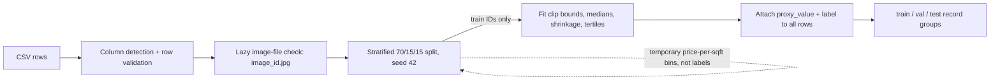
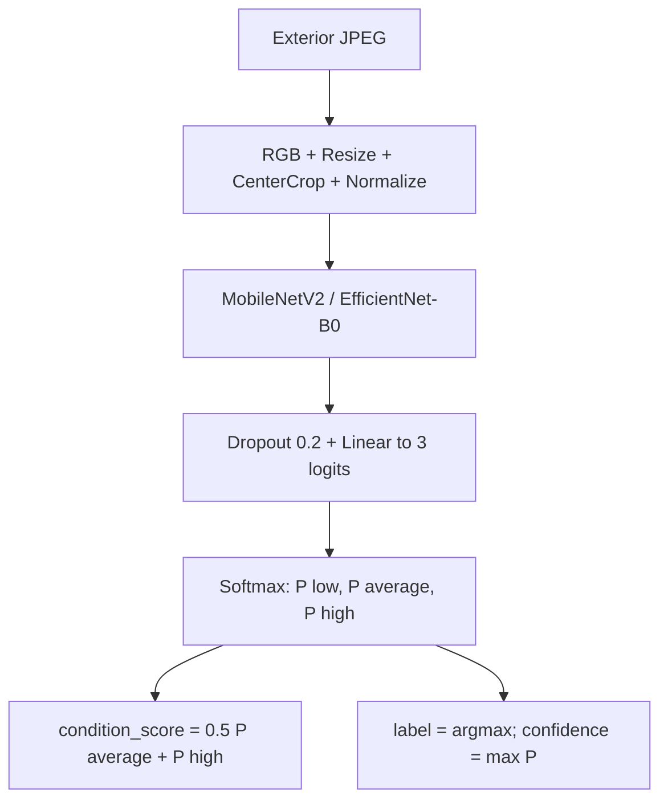
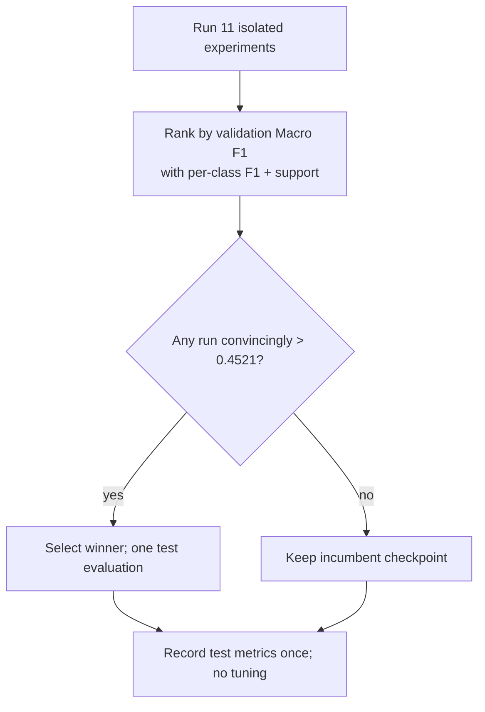
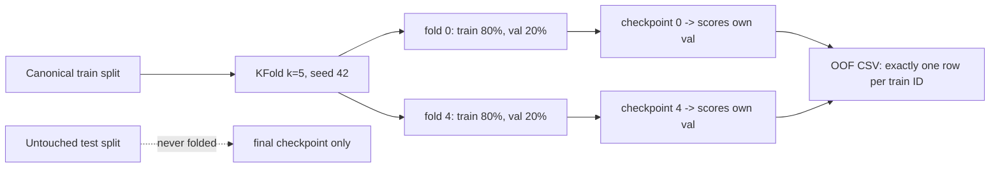
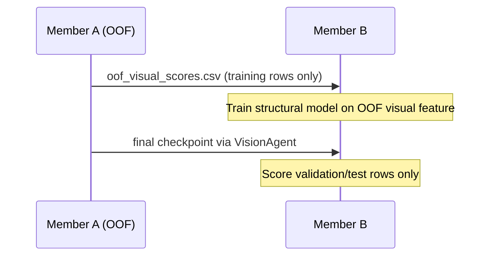

# Final Member A report — CNN visual proxy

**Status:** implementation, experiment harness, OOF tooling and demonstration
tooling are complete and locally checked. All **new** Kaggle GPU runs, the
one-time test evaluation of the winner, the leakage audit and the live demo are
`PENDING`. Historical results below are preserved verbatim and were not
re-measured.

> **Interpretation warning.** Every target is a **market-derived visual proxy**
> (a tertile of prices per square foot relative to a shrunken city median),
> **not** a human-annotated physical-condition or aesthetic grade, and **not** a
> price. `condition_score = 0.5·P(average) + 1·P(high)` is a soft feature only.
> See `docs/MODEL_CARD.md`.

---

## 1. Objective and scope

Member A delivers one reusable component: a CNN that maps a property exterior
photograph to a normalized visual-proxy feature for Member B's structural model.
The scope is strictly Member A — no Random Forest, no Linear Regression and no
final price prediction are implemented here.

The deliverables are (a) a self-contained checkpoint and stable `VisionAgent`
API, (b) a controlled experiment harness and audit trail, (c) out-of-fold (OOF)
scores so Member B never trains on in-sample visual features, and (d) this
report. The incumbent checkpoint remains
`/kaggle/working/output/improved_mobilenet/models/best_model.pth` until a new run
wins on validation Macro F1 and receives its single test evaluation.

## 2. Scientific problem and target definition

The dataset contains no human condition labels. The only available signal is
market-derived. The target is therefore defined explicitly and versioned:

| Version | Proxy value | City reference | Threshold source |
|---|---|---|---|
| `v1_legacy` | clipped `price/sqft` ÷ raw city median | raw city median, global fallback | tertiles of train ratios |
| `v2_log_shrunk` (default) | clipped `log(price/sqft)` − shrunk city log-median | `m̂_c = (n_c·m_c + K·m_global)/(n_c + K)`, `K=10` | tertiles of observed train values |

Classes are ordered `low` (0) < `average` (1) < `high` (2). All statistics —
clipping percentiles, global and city medians, shrinkage and tertiles — are
fitted on **training rows only** and stored in the checkpoint. Evaluation never
refits them and never reinterprets another version's thresholds. This is a
proxy-labelling study, so conclusions are about *market-relative visual signal*,
not about building condition.

## 3. Data and label construction



The split is stratified on temporary price-per-sqft quantiles purely for
balance; those bins are not training labels. Duplicate handling is currently by
normalized image-id stem only. Whether near-duplicate photos or same-street
listings cross splits is an **open empirical question** answered by
`src/data_audit.py` on Kaggle (`PENDING`) — see §9 and §13.

## 4. Model and training procedure

- **Backbones:** MobileNetV2 ImageNet V1 (default); EfficientNet-B0 for one
  controlled comparison. Fresh 3-class head, 224×224 crop (288→256→224 for the
  higher-resolution experiment).
- **Transforms:** Resize(256) → CenterCrop(224) → ImageNet normalization. Train
  time adds horizontal flip and restrained colour jitter; the `improved` recipe
  deliberately removes rotation and aggressive random crop so roofs and facades
  are not destroyed.
- **Optimization:** two phases — frozen backbone + head at `lr=1e-4`, then last
  `finetune_blocks=4` unfrozen at `lr_finetune=1e-5` with cosine decay and
  early stopping on validation Macro F1 (`patience=5`) in phase 2 only.
- **Selection metric:** Macro F1 over all three fixed labels
  (`labels=[0,1,2]`), so a class absent from one epoch cannot silently rescale
  the metric.
- **Output:** softmax probabilities; argmax `label`;
  `condition_score = 0.5·P(average) + P(high)` clipped to `[0,1]`;
  `confidence = max(P)` (explicitly **not** a calibrated confidence).



## 5. Experimental design and controls

Eleven experiments are defined in `configs/experiments.json` and executed by
`src/run_experiment.py`. Every comparable run uses seed 42, the same split, the
same `v2_log_shrunk` labels and the same selection metric; only the named factor
changes. Each run writes to its own output directory and records the resolved
config, exact commands and timestamps in `experiment_run.json`.

| Name | Changed factor | Purpose |
|---|---|---|
| `e0_reference` | none (fresh controlled baseline) | Reference for all comparisons |
| `e1_no_weighting` | no class weights, no label smoothing | Is imbalance handling helping? |
| `e2_balanced_ce` | balanced inverse-frequency CE | Always-on reweighting |
| `e3_effective_number` | effective-number weights β=.9999 | Gentler reweighting |
| `e4_focal` | focal γ=2 | Hard/noisy example focus |
| `e5_ordinal_smooth` | ordinal ε=.1 | Exploit class ordering |
| `e6_efficientnet_b0` | architecture | Backbone comparison |
| `e7_higher_resolution` | 256 crop from 288 | More facade detail |
| `e8_legacy_augmentation` | legacy augmentation | Is rotation/crop harmful? |
| `e9_shrinkage_k1` | label shrinkage K=1 | **Different label config**; report separately |
| `e10_longer_finetune` | 45 epochs, 8 blocks, patience 8 | Longer fine-tuning |



`e9` is not mixed into the loss comparison because it changes the label
definition. The frozen-feature logistic probe (`src/probe.py`) is a separate
diagnostic protocol, never reported as a CNN result.

## 6. Evaluation protocol

`src/evaluate.py` reloads the checkpoint, its saved split and its saved label
statistics; rebuilds the exact model; and evaluates **only the untouched test
split**. It reports accuracy, macro precision/recall/F1, weighted F1, per-class
precision/recall/F1/support, true-vs-predicted distributions, raw and normalized
confusion matrices, and baselines computed on that same split (majority class,
seeded uniform random). The test split is never used for early stopping,
statistics fitting or threshold tuning, and evaluation runs **once** for the
selected winner.

## 7. Historical measured results (preserved verbatim)

| Run | Split | Accuracy | Macro F1 | Notes |
|---|---|---:|---:|---|
| Original baseline (`v1_legacy`) | test | 0.4065 | 0.4057 | Different label methodology — **not** a controlled comparison |
| Improved MobileNetV2 (`v2_log_shrunk`) | validation | 0.4589 | 0.4521 | Best epoch 15 |
| Improved MobileNetV2 (`v2_log_shrunk`) | **test** | 0.4384 | 0.4309 | Macro precision 0.4323, macro recall 0.4362, weighted F1 0.4327 |
| Frozen ImageNet logistic probe | validation | 0.4580 | 0.4561 | Train→val only; diagnostic, not a CNN result |

Incumbent per-class **test** F1: low `0.4684`, average `0.3293`, high `0.4948`.
The frozen probe being essentially level with the CNN's validation F1 suggests
a feature/label ceiling rather than a classifier-head bottleneck — a
**hypothesis**, not a proven fact, which is why the experiment plan emphasizes
labels, losses and leakage over head tuning.

## 8. New experiment results (`PENDING`)

No new GPU run has been executed locally. Live metrics belong in
`docs/EXPERIMENT_RESULTS.md` and must come from `training_summary.json`,
`results/metrics.json` and checkpoint metadata. No number may be copied between
rows, estimated, or taken from a `--max_images` smoke test.

| Run | Best val Macro F1 | Val per-class F1 (low/avg/high) | Training duration | Peak VRAM | One-time test F1 |
|---|---:|---|---|---|---|
| `e0` … `e10` | PENDING | PENDING | PENDING | PENDING | PENDING (winner only) |

**Selection rule:** validation Macro F1 with per-class support reported; ties
broken by per-class F1 and support. If nothing convincingly beats **0.4521**,
the incumbent stays in production.

## 9. Integrity checks: leakage audit and OOF

Two distinct risks are handled separately.

1. **Data leakage.** `src/data_audit.py` is a read-only diagnostic for
   CSV→image matching failures, exact-byte and perceptual duplicates, and
   street/city groups spanning splits. Status: `PENDING` on Kaggle. If material
   leakage is found, held-out numbers are optimistic and must be reported as
   such — not silently fixed after seeing results.
2. **In-sample Member B features.** Five OOF folds are built from the
   **canonical training split only**; the test split is never folded. Each fold
   is trained via `train.py --split_file`, so label statistics are refitted on
   that fold's train rows only. Each held-out row is scored by the checkpoint
   that did **not** train on it, and the scripts fail closed on overlapping
   folds, test-id leakage or incomplete coverage.



Local unit tests in `tests/test_oof_contract.py` verify the isolation rules and
CSV columns without torch.

## 10. Member B hand-off

`VisionAgent` exposes `VisionAgent(device="cuda")`, `.load(path)`, `.score(path)`
and `.score_batch(paths, batch_size=64)`, with output fields `condition_score`,
`label`, `probabilities`, `confidence`, `model`, `score_type`. It handles RGB,
grayscale and RGBA inputs and never fabricates fallback scores.

| CSV column | Meaning |
|---|---|
| `image_id` | Original image identifier (join key) |
| `fold` | Which fold held this row out |
| `condition_score` | `0.5·p_average + p_high` from the held-out model |
| `p_low`, `p_average`, `p_high` | Full 3-class probability vector |
| `label` | Argmax class from that model |
| `confidence` | Max class probability (not calibrated) |
| `model`, `checkpoint` | Provenance of the scoring model |



Member B trains on the OOF scores and uses the selected final checkpoint only
for its held-out rows. OOF scores and experiment validation metrics are
different protocols and must never be mixed.

## 11. Reproducible live demonstration

`src/demonstrate.py` scores real images and writes `demonstration.html` plus
`demonstration.csv`. For each image the page shows the **original** image, the
predicted class, `P(low)/P(average)/P(high)`, the normalized `condition_score`,
and `confidence` explicitly labelled "max predicted class probability (NOT
calibrated)". It is a qualitative illustration, not held-out evidence; use
test-split images if generalization must be illustrated. Status: `PENDING` —
requires the Kaggle checkpoint and dataset. Exact command: section I of
`docs/KAGGLE_GUIDE.md`.

## 12. Reproducibility: commands, seeds and artifacts

Seed 42 is fixed for Python, NumPy, PyTorch and CUDA, with deterministic cuDNN.
Configs, exact commands, durations and peak GPU memory are recorded per run.
Copy-paste commands live in `docs/KAGGLE_GUIDE.md`; the minimal sequence is:

```python
!python -m unittest discover -s tests -v
!python src/run_experiment.py --list
!python src/run_experiment.py --name e0_reference --dry-run
!python src/run_experiment.py --name e0_reference   # repeat for e1..e10
!python src/data_audit.py --split_file /kaggle/working/output/experiments/e0_reference/models/split_indices.json
!python src/evaluate.py --output_dir /kaggle/working/output/experiments/<winner>  # ONCE
!python src/make_folds.py --n_folds 5 --seed 42 --output_dir /kaggle/working/output/oof
!python src/oof_predict.py --output_dir /kaggle/working/output/oof
!python src/demonstrate.py --checkpoint <winner>/models/best_model.pth --images_dir <dataset> --output_dir /kaggle/working/output/demonstration
```

| Artifact | Content |
|---|---|
| `models/best_model.pth` | Weights + architecture, class map, preprocessing, label stats, config, history |
| `models/training_summary.json` | Best epoch/F1, duration, peak VRAM, device, early stopping |
| `models/split_indices.json` | Exact train/val/test image IDs |
| `results/metrics.json`, `evaluation_report.md` | Headline, per-class and confusion-matrix metrics |
| `oof/oof_visual_scores.csv` | One honest out-of-fold score per training row |
| `demonstration/demonstration.html` | Real-image visual demonstration |

## 13. Limitations, threats to validity and future work

| Threat / limitation | Status | Mitigation or honest residual |
|---|---|---|
| Proxy labels (price-per-sqft tertiles) confounded by location, demand, timing | Inherent | Reported as a proxy, never as condition or price |
| Weak `average` class (test F1 0.3293) | Measured | Likely heterogeneous middle tertile; targeted experiments `e1`–`e5`, `e9` |
| Near-duplicate / same-street leakage | **Unmeasured (`PENDING`)** | `data_audit.py` reports it; held-out scores stay provisional until run |
| No human condition labels, calibration or uncertainty | Inherent | No calibrated condition claim; `confidence` is max probability only |
| Single-split results; no significance testing | Limitations | Macro F1 with per-class support reported; differences must be convincing |
| New experiments, winner test evaluation, OOF scores, demo | **Not executed locally** | Must be run on Kaggle; no result is claimed here |
| Regression head, validation-tuned thresholds, group-aware folds | Deferred | Would change the 3-class API or need leakage evidence first |

**Bottom line:** the methodology and tooling are in place and locally verified;
no performance improvement is claimed beyond the preserved historical numbers.
The incumbent checkpoint stays the default until Kaggle evidence justifies a
change.
